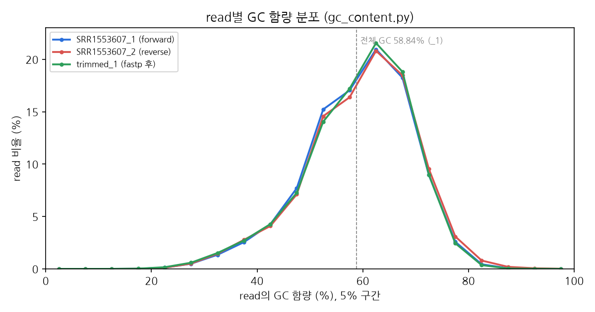

# gc_content.py 사용 설명서

FASTQ 파일을 읽어 **GC 함량**(서열에서 G와 C가 차지하는 비율)을 구하는 스크립트이다. 파일 전체의 GC 함량과 read별 GC 함량의 평균·중앙값·범위를 출력하고, 원하면 read별 GC% 분포를 TSV로 저장한다. FastQC 보고서의 "%GC" 값과 "Per sequence GC content" 그래프를 숫자로 확인할 수 있다.

- 위치: `lab11/src/gc_content.py`
- 필요 환경: Python 3 (표준 라이브러리만 사용, 추가 설치 없음)
- GC 계산은 `lab07/src/fasta.py` 의 `gc_content` 함수를 가져와 쓴다 (`sys.path` 에 `lab07/src` 추가). 그래서 `lab07/src/fasta.py` 가 있어야 한다.

## 1. 사용법

주차 폴더(`lab11`)에서 실행한다. 첫 번째 인자는 FASTQ 파일, 두 번째 인자(선택)는 GC% 분포를 저장할 TSV 파일이다.

```
cd lab11
python3 src/gc_content.py <FASTQ 파일> [분포 TSV]
```

| 실행 방법 | 동작 |
|---|---|
| 인자 2개 | 요약을 화면에 출력하고, GC% 분포를 TSV 파일로 저장 |
| 인자 1개 | 요약만 화면에 출력 |
| 인자 없음 | 사용법을 출력하고 종료 (종료 코드 1) |

### 실행 예시

```
$ python3 src/gc_content.py data/SRR1553607_1.fastq doc/gc_content_SRR1553607_1.tsv
read 개수: 203445
전체 GC 함량: 58.84%
read별 GC% 평균: 58.84%
read별 GC% 중앙값: 60.40%
read별 GC% 범위: 12.87% ~ 98.02%
저장: doc/gc_content_SRR1553607_1.tsv
```

### 화면 출력의 뜻

| 항목 | 뜻 |
|---|---|
| 전체 GC 함량 | 모든 read의 G·C 개수 합 ÷ 모든 염기 수 |
| read별 GC% 평균 | read마다 GC 비율을 구한 뒤 그 값들의 평균 |
| read별 GC% 중앙값 | read별 GC 비율을 정렬했을 때 가운데 값 |
| read별 GC% 범위 | read별 GC 비율의 최솟값 ~ 최댓값 |

### 분포 TSV 형식 (탭으로 구분)

| 열 | 뜻 |
|---|---|
| gc_percent | GC% (0~100, read별 GC%를 정수로 반올림) |
| reads | 그 GC%에 해당하는 read 수 |

## 2. 실행 결과

세 파일에 대해 실행해 분포를 `doc/` 에 TSV로 저장했다.

- `doc/gc_content_SRR1553607_1.tsv`
- `doc/gc_content_SRR1553607_2.tsv`
- `doc/gc_content_trimmed_1.tsv`

| 파일 | read 수 | 전체 GC | read별 평균 | 중앙값 | 범위 |
|---|---|---|---|---|---|
| SRR1553607_1 | 203,445 | 58.84% | 58.84% | 60.40% | 12.87 ~ 98.02% |
| SRR1553607_2 | 203,445 | 59.24% | 59.24% | 60.40% | 10.89 ~ 99.01% |
| trimmed_1 | 188,357 | 58.95% | 58.85% | 60.40% | 12.87 ~ 96.43% |



| 파일 | GC 40% 미만 | 40~50% | 50~70% | 70% 이상 |
|---|---|---|---|---|
| SRR1553607_1 | 4.5% | 12.0% | 71.5% | 12.1% |
| SRR1553607_2 | 4.9% | 11.2% | 70.2% | 13.7% |
| trimmed_1 | 5.0% | 11.5% | 71.6% | 11.8% |

- read의 70% 이상이 GC 50~70% 사이에 있고, 가장 많은 구간은 60~65% 이다.
- 분포가 오른쪽(GC 높은 쪽)으로 치우쳐 있고 왼쪽으로 꼬리가 길다. 그래서 중앙값(60.40%)이 평균(58.84%)보다 높다.
- forward(_1)와 reverse(_2)의 분포가 거의 같다. 같은 DNA 조각의 양 끝을 읽은 것이므로 자연스럽다.
- fastp 처리 후(trimmed_1)에도 GC 분포는 거의 바뀌지 않는다. fastp는 품질로 자르고 거르므로 GC 함량에는 큰 영향이 없다.
- 원본 파일은 read 길이가 모두 101 bp라 전체 GC와 read별 평균이 같다. trimmed_1은 길이가 제각각이라 두 값이 조금 다르다(58.95% vs 58.85%).

## 3. 코드 설명

### gc_content 가져오기

```python
sys.path.append(os.path.join(os.path.dirname(os.path.abspath(__file__)), "..", "..", "lab07", "src"))
from fasta import gc_content
```

스크립트 위치(`lab11/src`)에서 두 단계 올라가 `lab07/src` 를 import 경로에 추가한다. 어느 폴더에서 실행해도 찾을 수 있다. `gc_content(seq)` 는 `(G 개수 + C 개수) ÷ 서열 길이` 를 0~1 사이 값으로 돌려준다.

### read_fastq(filename)

`qual_summary.py` 와 같은 함수이다. 4줄씩 묶어 `(이름, 서열, 품질)` 튜플의 리스트를 돌려준다. 소문자 서열도 셀 수 있도록 서열은 `upper()` 로 대문자로 바꾼다.

### gc_summary(reads)

```python
def gc_summary(reads):
    total_gc = 0
    total_len = 0
    read_gc = []
    for name, seq, qual in reads:
        total_gc = total_gc + seq.count("G") + seq.count("C")
        total_len = total_len + len(seq)
        read_gc.append(gc_content(seq))
    overall = total_gc / total_len if total_len > 0 else 0.0
    return overall, read_gc
```

1. 모든 read의 G·C 개수와 길이를 더해 **전체 GC 함량**을 구한다.
2. read마다 `gc_content` 로 GC 비율을 구해 `read_gc` 리스트에 모은다.

### gc_distribution(read_gc)

read별 GC 비율에 100을 곱해 정수로 반올림하고, 0~100 각 칸에 read 수를 센다. 이 표는 분포 TSV에만 쓴다.

### median(values)

정렬한 뒤 가운데 값을 돌려준다. 개수가 짝수면 가운데 두 값의 평균이다.

### test()

```python
reads = [("r1", "GGCC", "IIII"), ("r2", "ATGC", "IIII"), ("r3", "AT", "II")]
```

손으로 계산할 수 있는 예로 확인한다. G·C는 10개 중 6개라 전체 GC는 0.6, read별로는 1.0 / 0.5 / 0.0, 중앙값은 0.5 이다. 스크립트를 실행할 때마다 먼저 돌아가며, 틀리면 `AssertionError` 가 난다.

## 4. 결과 검증

- **내장 테스트**: 스크립트를 실행할 때마다 `test()` 가 통과했다.
- **awk와 비교** (전체 GC):
  ```
  awk 'NR%4==2{l+=length($0); g+=gsub(/[GCgc]/,"")} END{print g/l*100}' data/SRR1553607_1.fastq
  ```
  SRR1553607_1: 58.84%, trimmed_1: 58.95% 로 스크립트 결과와 같다.
- **seqkit과 비교** (read별 평균):
  ```
  seqkit fx2tab -n -g data/SRR1553607_2.fastq | awk '{s+=$NF;n++} END{print s/n}'
  ```
  SRR1553607_1: 58.84%, SRR1553607_2: 59.24% 로 같다.
- **FastQC와 비교**: `doc/SRR1553607_1_fastqc.html` 의 Basic Statistics에서 %GC = 58 이다. "Per sequence GC content" 는 **fail** 이다. FastQC는 정규분포를 기대하는데, 이 데이터는 한쪽으로 치우쳐 있고 꼬리가 길어서 실패로 표시된다. 여러 생물(숙주·바이러스 등)의 서열이 섞여 있을 때 흔히 생긴다.

## 5. 반올림에 관한 주의 (만들면서 고친 점)

처음에는 read별 GC%를 정수로 반올림한 뒤 평균을 냈는데, 결과가 58.61% 로 실제 값(58.84%)보다 0.23 낮았다.

- read 길이가 101 bp이면 GC 비율은 0/101, 1/101, … 처럼 나온다. 예를 들어 G·C가 60개면 59.41% 인데 반올림하면 59 가 되어 0.41 이 깎인다. 이 데이터에 많은 55~65% 부근에서는 반올림이 거의 항상 아래로 일어나서 평균이 한쪽으로 치우쳤다.
- 같은 이유로 101개의 값이 101칸에 고르게 들어가지 않고 50% 칸에만 두 값(50/101, 51/101)이 들어간다. 그래서 "가장 많은 GC%" 를 반올림 분포에서 구하면 50% 처럼 잘못된 값이 나왔다.

그래서 **평균·중앙값·범위는 반올림하기 전 값으로** 구하고, 반올림한 값은 분포 TSV에만 쓴다. 분포 TSV를 1% 단위로 그래프로 그리면 들쭉날쭉해 보이므로, 이 설명서의 그래프처럼 5% 구간으로 묶어 보는 것이 좋다.

## 6. 주의할 점과 한계

- **N 등 다른 문자도 길이에 들어간다.** GC 비율의 분모가 서열 전체 길이이므로, N이 많은 read는 GC가 낮게 나온다. 이 데이터에서는 SRR1553607_2 의 read 3개에만 N이 모두 4개 있고, SRR1553607_1·trimmed_1 에는 없어서 결과에 거의 영향이 없다.
- **한 read가 정확히 4줄**이라고 가정한다. 여러 줄로 나뉜 FASTQ나 잘린 파일은 처리하지 못한다.
- **파일 전체를 메모리에 올린다** (`readlines()`). 수 GB 크기의 FASTQ에서는 메모리가 부족할 수 있다.
- **gzip 압축 파일**(`.fastq.gz`)은 바로 읽지 못한다. 먼저 압축을 풀어야 한다.
- **빈 파일**이면 평균을 구할 때 `ZeroDivisionError` 가 난다.
- **FASTA 파일은 읽지 못한다.** FASTA의 GC 함량은 `lab07/src/fasta.py` 를 직접 실행해 확인한다.
