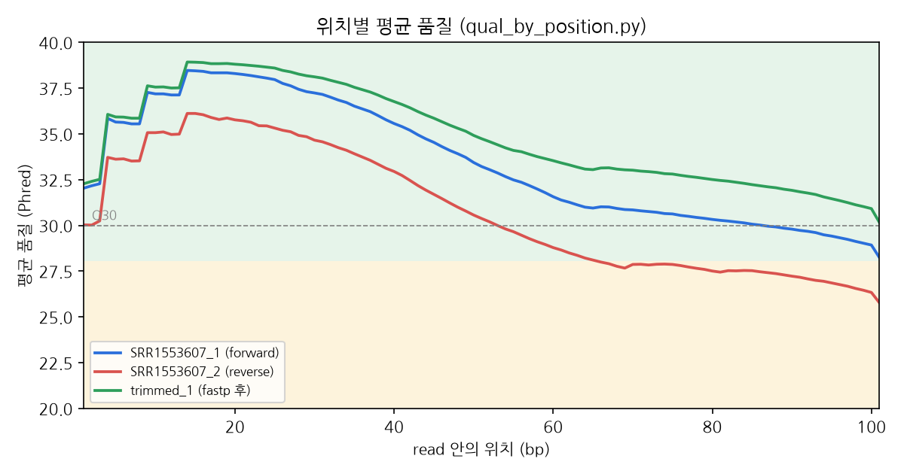

# qual_by_position.py 사용 설명서

FASTQ 파일을 읽어 **read 안의 위치(1번째 염기, 2번째 염기, …)마다 평균 품질 점수(Phred)** 를 구하는 스크립트이다. FastQC 보고서의 "Per base sequence quality" 그래프와 같은 값을 숫자 표로 얻을 수 있다.

- 위치: `lab11/src/qual_by_position.py`
- 필요 환경: Python 3 (표준 라이브러리만 사용, 추가 설치 없음)

## 1. 사용법

주차 폴더(`lab11`)에서 실행한다. 첫 번째 인자는 FASTQ 파일, 두 번째 인자(선택)는 결과를 저장할 TSV 파일이다.

```
cd lab11
python3 src/qual_by_position.py <FASTQ 파일> [출력 TSV]
```

| 실행 방법 | 동작 |
|---|---|
| 인자 2개 | 결과를 TSV 파일로 저장하고, 화면에는 read 개수·최대 길이·저장 경로만 출력 |
| 인자 1개 | 결과 표를 화면에 출력 |
| 인자 없음 | 사용법을 출력하고 종료 (종료 코드 1) |

### 실행 예시

```
$ python3 src/qual_by_position.py data/SRR1553607_1.fastq doc/qual_by_position_SRR1553607_1.tsv
read 개수: 203445
최대 길이: 101
저장: doc/qual_by_position_SRR1553607_1.tsv

$ python3 src/qual_by_position.py data/SRR1553607_1.fastq | head -4
position	reads	mean_qual
1	203445	32.04
2	203445	32.17
3	203445	32.28
```

### 출력 형식 (TSV, 탭으로 구분)

| 열 | 뜻 |
|---|---|
| position | read 안의 위치 (1부터 시작) |
| reads | 그 위치까지 길이가 닿는 read 수 |
| mean_qual | 그 위치 품질 점수의 평균 (소수 둘째 자리) |

## 2. 실행 결과

세 파일에 대해 실행해 `doc/` 에 TSV로 저장했다.

- `doc/qual_by_position_SRR1553607_1.tsv`
- `doc/qual_by_position_SRR1553607_2.tsv`
- `doc/qual_by_position_trimmed_1.tsv`

| 위치 | SRR1553607_1 | SRR1553607_2 | trimmed_1 | trimmed_1 read 수 |
|---|---|---|---|---|
| 1 | 32.04 | 30.03 | 32.28 | 188,357 |
| 10 | 37.19 | 35.07 | 37.56 | 188,357 |
| 25 | 37.97 | 35.32 | 38.60 | 188,357 |
| 50 | 33.44 | 30.57 | 34.92 | 188,357 |
| 75 | 30.63 | 27.87 | 32.81 | 182,061 |
| 90 | 29.80 | 27.23 | 31.92 | 175,373 |
| 101 | 28.25 | 25.78 | 30.17 | 171,032 |



- 세 파일 모두 **14번째 위치에서 가장 높고**(38.47 / 36.12 / 38.93) 뒤로 갈수록 떨어진다. Illumina 시퀀싱에서 cycle이 진행될수록 품질이 낮아지는 전형적인 모습이다.
- 맨 앞 몇 염기는 조금 낮다. 시퀀싱 초반 보정 단계의 영향이다.
- forward(_1)는 **87번째**부터 평균이 Q30 아래로 내려가고, reverse(_2)는 **54번째**부터 내려간다. reverse read가 전 구간에서 2~3 정도 낮다.
- fastp 처리 후(trimmed_1)에는 **모든 위치가 Q30 이상**이다. 끝부분이 나쁜 read는 잘려 나가서 뒤쪽 위치의 read 수가 줄어든다(위치 101: 171,032개).

## 3. 코드 설명

### read_fastq(filename)

`parse_fastq.py`, `qual_summary.py` 와 같은 함수이다. 파일을 4줄씩 묶어 `(이름, 서열, 품질)` 튜플의 리스트를 돌려준다.

### qual_by_position(reads)

```python
def qual_by_position(reads):
    sums = []
    counts = []
    for name, seq, qual in reads:
        for i, ch in enumerate(qual):
            if i == len(sums):
                sums.append(0)
                counts.append(0)
            sums[i] = sums[i] + (ord(ch) - 33)   # Phred+33
            counts[i] = counts[i] + 1
    means = []
    for i in range(len(sums)):
        means.append(sums[i] / counts[i])
    return means, counts
```

1. `sums[i]` 에는 i번째 위치 품질 점수의 합, `counts[i]` 에는 i번째 위치까지 온 read 수를 모은다.
2. `enumerate(qual)` 로 위치 번호 `i` 와 품질 문자 `ch` 를 함께 꺼낸다.
3. 지금까지 본 read보다 긴 read가 나오면(`i == len(sums)`) 리스트에 칸을 하나 늘린다. 그래서 read 길이를 미리 알 필요가 없다.
4. `ord(ch) - 33` 으로 문자를 Phred 점수로 바꿔 더한다.
5. 마지막에 위치마다 `합 ÷ read 수` 로 평균을 구한다. **위치마다 실제로 그 위치에 있는 read 수로 나누므로**, fastp로 잘려 길이가 제각각인 파일도 바르게 계산된다.

### test()

```python
def test():
    reads = [("r1", "ACG", "I?5"), ("r2", "AC", "5+")]
    means, counts = qual_by_position(reads)
    assert means == [30.0, 20.0, 20.0], means
    assert counts == [2, 2, 1], counts
```

손으로 계산할 수 있는 예로 함수를 확인한다 (`I`=40, `?`=30, `5`=20, `+`=10). 길이가 다른 두 read를 넣어 3번째 위치는 read 1개로만 나누는지도 확인한다. 스크립트를 실행할 때마다 먼저 돌아가며, 틀리면 `AssertionError` 가 난다.

### 메인 부분

- 인자가 없으면 사용법을 출력하고 끝낸다.
- 두 번째 인자가 있으면 그 파일을, 없으면 화면(`sys.stdout`)을 출력 대상으로 정한다.
- 헤더 줄과 위치별 결과를 탭으로 구분해 쓴다. 위치는 사람이 읽기 쉽게 1부터 센다(`i + 1`).

## 4. 결과 검증

- **내장 테스트**: 스크립트를 실행할 때마다 `test()` 가 통과했다.
- **다른 방법과 비교**: awk로 1번째 품질 문자만 뽑아 따로 평균을 내면 32.0407 로, 스크립트 결과(32.04)와 같다.
  ```
  awk 'NR%4==0{print substr($0,1,1)}' data/SRR1553607_1.fastq
  ```
- **qual_summary.py 와 비교**: 위치별 평균을 read 수로 가중 평균하면 염기 전체 평균이 되어야 한다.

  | 파일 | 위치별 결과의 가중 평균 | qual_summary_manual.md 의 값 |
  |---|---|---|
  | SRR1553607_1 | 33.4499 | 33.4497 |
  | SRR1553607_2 | 30.8311 | 30.8308 |
  | trimmed_1 (염기 전체 평균) | 34.9127 | 34.912 |

  (소수 셋째 자리 이하 차이는 TSV에 소수 둘째 자리까지만 저장한 데서 생긴다.)
- **FastQC와 비교**: `doc/SRR1553607_1_fastqc.html` 의 "Per base sequence quality" 그래프와 모양이 같다. 단, FastQC는 뒤쪽 위치를 몇 개씩 묶어(예: 50-51, 52-53) 보여 준다.

## 5. 주의할 점과 한계

- **Phred+33 만 가정**한다. 오래된 Illumina(1.3~1.7)의 Phred+64 파일은 점수가 31씩 높게 나온다.
- **한 read가 정확히 4줄**이라고 가정한다. 여러 줄로 나뉜 FASTQ나 잘린 파일은 처리하지 못한다.
- **파일 전체를 메모리에 올린다** (`readlines()`). 수 GB 크기의 FASTQ에서는 메모리가 부족할 수 있다.
- **gzip 압축 파일**(`.fastq.gz`)은 바로 읽지 못한다. 먼저 압축을 풀어야 한다.
- 평균만 구하므로 위치별 분포(중앙값, 사분위수)는 알 수 없다. FastQC 상자그림과 비교할 때 이 점에 주의한다.
- read 길이가 다른 파일에서는 뒤쪽 위치일수록 `reads` 가 적어 평균이 덜 안정적이다. `reads` 열을 함께 본다.
